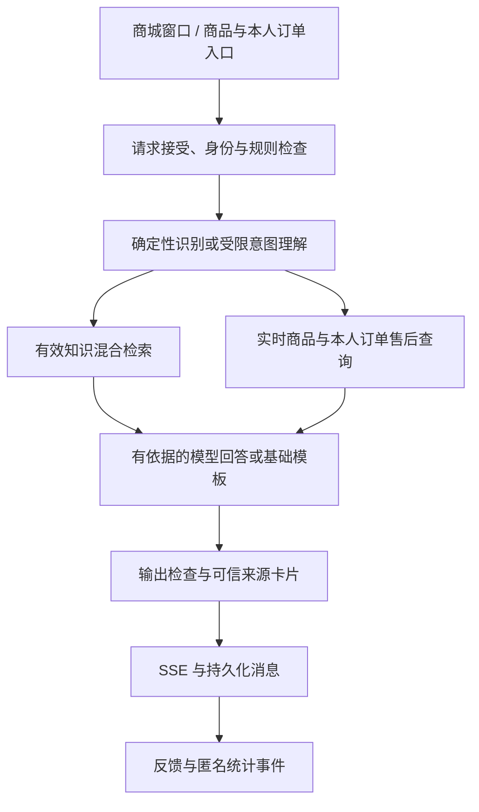

# Design

## Context

动机及范围参见 `proposal.md`，外部行为以本变更七份 `specs/*/spec.md` 为准。本轮只创建规划制品，用户审核后才启动 apply。

已检查的实现与约束：

- 后端为 Java 17、Spring Boot 3.5.16、Spring MVC、JWT、MyBatis-Plus、MySQL 8 和 Flyway；目前没有 AI 包、模型 SDK、向量库或本地模型。最高迁移为 V8，H2 使用独立测试 schema。
- 前端为 Vue 3、TypeScript、Pinia、Axios 和 Element Plus，统计页已用 ECharts。`App.vue` 只承载路由，适合挂载跨商城页面的单例客服；现有 Axios 超时为十秒，不能直接用于长连接。
- 商品已保存名称、介绍、产地、口感、储存方法及可售 SKU，缺少甜度、月份、礼盒和用途字段。产品服务已有版本与状态规则；库存是 SKU 实物减预留，必须实时计算。
- `OrderService.buyerDetail`、`AfterSaleService.buyerDetail` 已检查归属，但现有详情 DTO 含电话及地址，不能直接作为模型上下文。物流为管理员登记节点，退款为 `SIMULATED_SUCCESS`；退款金额与时间需从退款记录补充安全投影。
- 当前退款限待发货，退货退款限确认收货后七天。售后知识可解释这些规则，不能替代服务端校验或承诺换货。
- 后台已分 OWNER/STAFF，权限在每次请求读取数据库；未分类接口默认拒绝。新增 AI 域必须同时更新权限约束、认证返回、导航和服务端分类。模型设置采用 OWNER 边界。
- `openspec-cn list --specs` 当前为空。早期变更中的离线 ONNX/模板设计是历史规划，本次明确替代其 AI 技术约束；未来同步/归档须协调差异，不能重新恢复旧在线禁止规则。

## Goals / Non-Goals

**Goals:**

- 把语言理解、知识检索、实时业务事实和界面卡片分开，模型不拥有身份决定权和写入业务的工具。
- 通过数据库状态、不可变知识版本和有界后台任务保证单机服务可恢复，清楚区分回答完成与未完成。
- 基础咨询不依赖在线接口；在线能力有可验证配置、明确限额、可追溯来源和真实使用统计。
- 保持已有商品/订单/库存与权限数据兼容，默认不向已有店员开放新增 AI 权限。

**Non-Goals:**

- 首版不引入 Redis、独立向量数据库、消息队列、ONNX 模型、分布式会话或多实例性能承诺。
- 不实现无限上下文、自主 Agent 循环、生成任意查询、全自动敏感内容识别、自动政策审核或人工客服工单。
- 不把模型公开评测、推理速度或费用作为已实测结果；真实账户的模型能力、地区和费用须在配置测试与专项验收中验证。

## Decisions

### 1. Spring AI 选型、模型推荐及适配边界

推荐百炼中国内地工作空间，生成模型先选 `qwen3.7-plus`，向量模型先选 `text-embedding-v4`、1024 维。理由是中文商城咨询场景和同一供应商维护便利；截至 2026-11-16 官方模型选择页将 `qwen3.7-plus` 定位为性能、速度与成本均衡，V4 向量文档说明支持多语言和 64–2048 自定义维度。本项目尚未用真实 Key 测试，不据此承诺特定延迟或费用。

配置使用 OpenAI 兼容的 chat/completions 与 embeddings 协议，但地址不写死为旧 DashScope 地址。官方当前文档给出工作空间形式，如 `https://{WorkspaceId}.cn-beijing.maas.aliyuncs.com/compatible-mode/v1`；部署时按控制台实际接口填写并测试。聊天与向量可以独立替换供应商、Key 和模型。

已于 2026-11-17 确认采用 Spring AI 1.1.8：该 1.1.x 系列官方支持 Spring Boot 3.4/3.5，匹配当前 Java 17 与 Boot 3.5.16。使用 BOM 统一模型/向量 Starter、ChatClient 和 RAG 模块版本；Spring AI 2.0.x 面向 Boot 4.0/4.1，当前不为 AI 模块升级整个业务应用。

底层模型通信、结构化结果转换和流式响应由 Spring AI 的 `ChatClient`/`ChatModel`、`EmbeddingModel` 处理。领域层保留薄适配层管理配置快照、供应商能力、超时/额度、安全投影及统一错误。知识问答使用 `RetrievalAugmentationAdvisor` 和受控的 `DocumentRetriever`，把现有 MySQL 混合检索结果转换为带修订/来源元数据的 Document。数据库发布、同步和授权仍在业务服务中执行。

生成流程最多一次结构化意图调用和一次回答调用；确定性业务/FAQ路径可以减少调用。禁用未纳入预算的自动查询改写、Agent循环及默认工具执行，并对框架的自动重试显式设定受限策略。结构化结果只允许已定义场景、实体候选、需求条件和检索改写，不要求模型生成 SQL 或任意工具；模型结果转换仍须业务DTO校验。

后台模型配置是数据库版本化的动态配置，不能只依赖启动时的单例模型自动配置。按已验证且启用的配置快照构建 Spring AI 模型/client，并以有界版本缓存复用；新版本供新请求使用，活动请求继续持有原实例，停用/淘汰后按资源生命周期释放。未配置或关闭 AI 时禁用会强制要求API Key的默认模型创建，按需构建在线能力，基础咨询可独立启动。HTTP传输须支持地址策略、连接/空闲超时、重定向限制及取消传播；框架默认日志、自动记忆或重试不能绕过既有边界。

模型配置删除按已确认规则处理：无回答/索引引用的版本永久删除，历史引用版本用 `deleted_at` 从管理列表隐藏并保留原快照。当前激活、活动回答及 BUILDING/READY/ACTIVE 索引代次或待处理/运行任务阻止删除。删除、激活及索引构建/切换复用店主行锁；请求接受锁定配置直到引用写入提交，避免检查与使用竞争。管理端读取/继承/测试/激活/构建拒绝隐藏版本，历史读取保留版本名称；删除提交后清除版本 client 缓存并写审计。V11 新增隐藏时间和列表索引，不改写 V9/V10 已部署迁移。

默认不显示思考过程；供应商是否支持关闭思考等扩展参数由能力配置及测试决定，不无条件发送。模型名可替换，实际使用名称、配置版本及供应商返回 usage 均记录；未返回 usage 时保存缺失值。

框架备选：LangChain4j 的声明式 AI Services、RAG 和 Spring Boot Starter 同样适用；当前选 Spring AI 以统一现有 Spring 应用的配置、依赖及观测体系。AgentScope Java 的事件流、恢复及工具审批适合后续复杂Agent流程，当前受控问答与只读业务查询采用更直接的Spring服务结构。最初手工HTTP适配方案改为Spring AI，减少供应商协议、响应解析及流式封装的维护工作；前台SSE业务协议和请求状态仍由本项目控制。

模型备选：DeepSeek 可作为未来兼容的生成替换，但仍需独立验证向量服务；本地 ONNX＋在线聊天增加模型准备负担，当前不采用；专用 RAG 平台会把知识治理及会话授权分散到外部，本项目先保留在现有后端。

官方依据（核对日期 2026-11-16）：

- 模型选择：https://help.aliyun.com/zh/model-studio/models
- 兼容接口：https://help.aliyun.com/zh/model-studio/compatibility-of-openai-with-dashscope
- V4 向量：https://help.aliyun.com/zh/model-studio/text-embedding-v4

框架依据（核对日期 2026-11-17）：

- Spring AI 1.1 / Boot 3.4–3.5：https://docs.spring.io/spring-ai/reference/1.1/getting-started.html
- Spring AI 2.0 / Boot 4.0–4.1：https://docs.spring.io/spring-ai/reference/getting-started.html
- LangChain4j Spring集成：https://docs.langchain4j.dev/tutorials/spring-boot-integration/
- AgentScope Java：https://github.com/agentscope-ai/agentscope-java

### 2. 请求处理流程与身份边界

身份只有访客与买家两个咨询域；管理员使用商城时仅公共咨询，不借后台角色访问任意买家订单。买家 ID 从 JWT 读取。访客通过后端生成的高熵不透明 token 绑定当前浏览器会话，token 存 `sessionStorage`、不放 URL，服务端只保存 token 哈希并限定二十四小时。访客上下文同样落库以完成请求状态和当前会话续聊，但不提供跨设备历史，内容二十四小时后清理。

前端咨询状态由独立 Pinia store 管理；登录、退出、凭据过期或账户切换终止旧身份流并清除上下文。登录后不自动迁移访客消息；用户在买家身份重新发起咨询。窗口关闭仅隐藏组件，流由 store 保持；页面离开商城或身份切换才主动停止其当前流。

每轮使用明确的绑定实体：商品 ID、订单 ID、售后 ID 和用户条件。前端传来的关联 ID 和模型产生的候选均需服务端验证。订单号搜索只在 `buyer_id=当前主体` 范围内；查不到与他人单号使用相同提示。多个订单/售后对象显示选择卡片，选定后再查询。只有用户明确选定的对象写入上下文；新的用户表达可替换旧条件，硬条件冲突时追问。

上下文只读取最近十个已完成问答对，并限制历史字符预算；再携带当前确认实体和需求，不做额外模型摘要。会话历史通过受控消息接入ChatClient，不启用会自动写入全部生成内容的默认记忆Advisor，避免失败/停止/拦截文本进入下一轮或形成第二套历史。每轮重新读取价格、可售库存、订单与退款数据。

备选：仅把全量历史发送给模型实现简单，但费用、隐私及错误累积不可控；前端传 buyerId 或任由模型选择订单缺乏可靠归属边界。

### 3. 商品扩展、实时事实及推荐

在 `fruit_product` 新增 `sweetness_description`（可空、最多二百字）、`seasonal_months`（可空 JSON 整数数组）、`is_gift_box`（默认零）、`use_cases`（可空 JSON 枚举数组）。场景首版为日常食用、长辈送礼、亲友送礼、商务送礼、家庭分享；该属性只描述商品用途，不等于健康或医疗建议。空数组/空值表示未提供，不视为全部月份或全部用途。

DTO 使用可识别字段是否出现的更新语义：旧请求未传新增字段时保留已有资料，明确传空值/空集合才能清除，礼盒 `false` 可显式取消。沿用产品 version 校验和现有库存规则，不改写历史迁移。前端产品编辑提供描述、月份多选、礼盒开关和用途选择，详情只显示已填写信息。

推荐后端按当前可见商品、有效 SKU、可售库存、预算、礼盒、月份、明确用途执行硬筛选；口味以已维护描述作软排序。当前月份取 Asia/Shanghai；用户指定月份优先。预算按一份候选 SKU 的价格解释，若用户要求多份礼盒则先确认份数。返回最多三件不同商品，每件带一个合适规格、真实价格/库存和理由依据。没有匹配时不自动放宽条件。

商品知识与这些字段关联；当前事实优先级为实时商品数据、当前系统业务限制、已发布商品补充知识、通用知识。任一来源未给出糖度等数值时只说明未提供。人工商品知识页面展示已关联事实，提示冲突；不允许人工文档替换结构化商品字段。

备选：全部用自由文本生成推荐无需改商品，但无法验证应季/礼盒硬条件，已获用户允许采用结构化资料。

### 4. 知识发布、混合检索及向量版本

知识种类为 FRUIT、PRODUCT、FAQ、POLICY，手工文档保存草稿与不可变修订，商品生成文档保存关联商品及产品版本。FAQ 包含标准问题、同义问法、答案，政策页面同时展示当前系统售后条件，管理员可比较并协调文案；不承诺对任意政策文字自动完成语义冲突审核。

分块先按段落及句子，建议每块四百至八百中文字符、最多一百字重叠，保留标题、类型、版本和来源。本地字词检索、FAQ 精确匹配和有效知识块在 MySQL 持久化；语义向量由Spring AI EmbeddingModel生成并存JSON，记录供应商/模型/维度/索引代次。在当前小规模语料中受控DocumentRetriever按兼容代次读取向量并算余弦，用序数融合关键词与语义候选，不直接混合不同范围的原始分数。首版不依赖Spring AI内存VectorStore作为知识真源，也不假定MySQL 8具有框架内置的专用向量检索能力。初始最多六块、知识摘要最多四千字；限定扫描规模并以实际验收调整阈值，无有效依据时不强行回答。

发布流程用数据库任务实现，不增加消息平台。草稿生成新修订，任务按文档版本和索引 profile 构建；有效内容与激活指针在短事务切换，模型调用在事务外执行。向量启用时需新修订完整索引成功才能切换，失败保留原有效版本；向量未配置/禁用时，完整的关键词/FAQ 索引即可发布为 keyword-only 状态，保证首次没有模型也能准备基础 FAQ。

文档停用立即更新可检索条件，迟到任务比较文档修订和状态后丢弃；旧有效修订不被新草稿覆盖。商品编辑后旧商品修订立刻因产品 version 不符而失效，新向量未就绪时用当前商品资料及关键词模式回答。下架/删除/分类停用同时在检索及卡片输出阶段校验，不能仅依赖异步索引任务。

Embedding 配置变化产生新索引 profile；为所有当时有效文档建新索引，建期间的文档变化加入追赶任务，切换前核对当前有效版本全部就绪。新旧 profile 分开，查询向量必须匹配当前 profile。若旧接口已不可用且新索引未完整，暂用关键词，不比较不同维度的向量。任务保存租约、重试次数及脱敏错误，重启可恢复；重试不自动激活停用文档。

历史回答保存经过验证的引用快照（标题、修订、短摘要）用于追溯，当前文档改变/停用不改写历史回答；新追问必须重新检索。删除会话同时清理引用快照。

备选：只做关键词检索不足以支持自然表达，纯向量检索对精确 FAQ 和模型故障不稳；专用向量库可提升规模性能，但当前增加部署成本。

### 5. 业务回答与模型生成职责

只开放知识检索、公开商品查询/筛选、本人订单查询、本人物流及本人售后/退款查询。每个参数使用受限 DTO，执行前校验权限和对象归属；内部主体不可由模型覆盖。不运行 SQL 文本、 arbitrary HTTP、退款、购物车写入或业务状态变更。

订单与退款的核心答案及卡片由确定性模板组织，避免模型改写状态、金额和到账承诺。安全业务投影包含订单号、商品快照摘要、状态、最近节点、售后阶段、实际退款金额及记录时间，排除姓名、电话、详细地址、支付凭据和审核内部信息。复杂自然追问可用受限意图理解找到已确认对象，但最终事实展示仍由后端输出。

水果、商品知识及一般政策回答通过ChatClient与受控RAG Advisor依据检索摘要生成，系统固定提示要求简短中文、缺失事实追问或说明、来源标识、仅使用已提供证据。Advisor只能使用已通过有效版本/归属过滤的Document，不自动检索全部会话或调用业务写工具。店主提示模板只配置语气与业务表达，固定授权/证据/只读约束不进入可替换模板。模板变量为问题、必要历史、知识摘要、公开商品事实及系统政策摘要，未知变量拒绝。

来源卡片、商品/订单链接由后端生成并验证，模型不能任意创建。前端初版以安全文本及有限排版显示，不渲染原始 HTML、不执行模型链接；引用编号只能指向本轮提供的已验证来源。事实与来源卡片不能证明模型每一句完全正确，需专门质量验收及反馈迭代。

备选：让模型直接生成全部业务状态更自然，但存在错报金额/进度的风险；自主 function-calling 循环对该毕业项目增加复杂性且缺乏必要的业务收益。

### 6. 基础降级与故障选择

区分回答来源 LLM、BUSINESS、FAQ、CATALOG 和 DEGRADED，以及检索模式 HYBRID/KEYWORD。正常直接查询业务无需伪装为模型生成；仅在线服务不可用时显示基础服务提示。

无 Key、AI 关闭、接口失败/超时、全局调用额度用完时：

- 已确认本人订单/售后对象使用只读模板，未指定对象显示本人候选卡片。
- FAQ 仅以标准问法、管理员同义问法或可靠的关键词规则匹配，返回标准答案和版本。
- 已明确商品的产地、口感、储存方法及甜度资料可以直接回答；可靠结构化条件可推荐商品。
- 未可靠识别的自然表达要求用户点选场景或对象，不能虚称具备完整离线语义理解。

向量失败而聊天正常时允许以可靠关键词依据继续生成并标记检索降级。聊天尚未输出时可切换基础路径，记录各次外部失败与实际使用；输出后发生故障则结束原失败尝试，不把基础答案拼到已显示的模型文本。用户重试可产生独立的基础尝试。

基础 FAQ 的演示数据从项目既有规则及管理员确认内容准备；行业常识须标为知识资料，未知配送时效、换货承诺或商品实测数值不作为店铺既定政策初始化。

### 7. SSE 接口、幂等与持久化生命周期

采用先接受请求、再订阅流的两阶段协议，便于拿到 requestId 后执行停止、状态恢复和安全重试：

1. `POST .../conversations/{id}/messages` 带 clientRequestKey，短事务创建唯一用户消息、回答尝试、统计事实及会话生成占用，返回 requestId/status。
2. `GET .../requests/{id}/stream` 通过 fetch 的 Authorization 或访客 token header 订阅 SSE；只允许归属主体。首次合法连接通过状态条件把 ACCEPTED 变为 RUNNING 并启动任务；接受后三十秒未订阅则终结为未连接，释放占用。
3. 元数据事件包含 messageId、requestId、seq、配置版本；随后发 status/delta，最终发 cards、sources 及唯一 done。heartbeat 只用于保活，不能延长首内容或整轮超时。流前错误为统一 JSON；流后错误必须转为事件与数据库终态。
4. 已终结请求重新订阅返回持久化终态及结果；正在运行的重复订阅返回明确冲突，客户端读取状态/历史，不启动第二个 worker。首版不实现逐 token 断线自动重放。

前端用 `fetch`＋流读取和增量 TextDecoder，使用与现有 JWT 相同的认证过期清理事件，不复用 Axios 的十秒超时；支持分割 UTF-8、跨网络块 SSE 帧和多行 data。关闭窗口不销毁 store 中的订阅；点击停止先调用停止端点，再取消本地读取。

每个客户端发送 key 在身份/会话范围唯一。相同 key 但不同负载返回冲突；相同 key/负载返回原请求。主动重试创建新尝试、新幂等 key，但关联原用户消息，不再新增问题。会话层条件占用只允许一条生成中尝试；接受重复与回收租约必须在数据库保证，不只靠前端禁用按钮。

尝试状态为 ACCEPTED、RUNNING、COMPLETED、DEGRADED、FAILED、CANCELLED、BLOCKED。终态通过条件更新只写一次，同时释放会话占用和更新统计；不把重试当作同一尝试重新运行。输出每五百毫秒或二百五十六字做安全文本 checkpoint，终态前保存最终文本。进程重启回收失效租约并标为 PROCESS_RESTART 失败；不自动复发模型调用。

停止/删除请求使用取消标识与Spring AI流式订阅的取消句柄终止上游，必要时取消受控意图调用；必须验证取消实际传播到HTTP传输，而不能仅停止前端渲染。每次持久化及输出前确认尝试仍有效、会话未删除且 generation epoch 未变；迟到的框架回调不能改写终态或恢复已删除正文。断线由 emitter completion/error 执行同一取消路径，状态即使在失败回调也能幂等收敛。

后端保持Spring MVC的SseEmitter，将Spring AI的流式ChatResponse订阅桥接为业务SSE；使用模型响应对象保留usage与元数据，并在发送delta前经过输出检查。数据库checkpoint在有界工作线程执行，不阻塞HTTP反应式事件线程；默认四个活动生成任务、最多十六个等待位。模型调用不占用长期数据库事务，所有emitter、订阅、传输资源及会话占用在终结路径统一释放，无需把整个商城改为WebFlux。

备选：单 POST 直接流式更少接口，但请求 ID 在首帧丢失时难以停止或恢复；原生 EventSource 不便附带现有 JWT header，因此选择 fetch。

### 8. 规则、凭据、限额与在线数据边界

规则支持 literal substring 与输入关键词 ALL/ANY 组合，范围 INPUT/OUTPUT、优先级、固定提示及启停。输出仅支持可计算最大词长的文字匹配，避免任意正则带来的无限回看。输入检查在外部调用前；输出保留最长输出敏感词长度减一的未发送后缀，扫描拼接后的内容后才释放安全前缀，末尾终结前再检查后缀。跨片段命中丢弃未释放内容并终止，不能在发出后再删除掩盖。测试覆盖跨块、末尾、长词、Unicode 解码及不同规则优先级。首版文字匹配不宣称覆盖所有语义攻击。

原始命中输出不写可见历史，输入只保留脱敏副本；拒绝工具和规则命中保存标识、版本、阶段及脱敏摘要。外部上下文用字段白名单，并对自由文本的可识别电话、邮箱和详细地址片段做尽力脱敏；入口说明使用在线模型，不能保证自由文本绝对匿名。

模型 Key 使用 AES-GCM、随机 nonce、密钥标识和部署环境 `AI_CONFIG_ENCRYPTION_KEY` 加密。API 只返回 hasKey/maskedKey，未提交新 Key 保留原值，明确操作才清除；前端不放 localStorage/sessionStorage，后端与第三方原始错误不直返。密钥缺失或错误仅使在线配置不可用，仍保留基础咨询。主密钥轮换通过显式本机重加密步骤完成，不隐式更换导致已存 Key 丢失。

接口只允许 HTTPS 及预配置供应商域名策略，解析目标并拒绝回环、私网、元数据和嵌入用户信息；不自动跟随跨目标重定向。需要本地 mock 测试时通过测试 profile 或显式部署白名单开放回环，不在生产默认开放。读取/测试草稿与正式调用使用同一验证和日志脱敏。

推荐可配置默认值：每问最多一千字，历史最多三千字，输出上限一千二百 tokens，温度 0.2；连接十秒、首有效内容二十秒、流空闲十五秒、整轮九十秒。每轮最多两次生成调用，瞬时网络失败最多在未输出/未接受供应商结果前重试一次且受总预算限制。访客每分钟三问/每天二十问，买家每分钟十问/每天一百问，全站每天一千次外部生成调用；接口测试同样计调用额度，后台索引使用独立有界队列。

短时频率用有界内存计数，访客同时加来源 IP 限制，持久日额度在 MySQL 原子预占/结算，重启不能重置全部额度。频率拒绝返回 429/retryAfter，未接受的限流不计问题；已接受后发现供应商额度或配置问题走基础降级。首版限额适用于单实例，未来多实例需改集中限额。

### 9. 数据结构与清理

| 表/数据 | 核心职责与约束 |
| --- | --- |
| `ai_knowledge_document` | 类型、关联商品、草稿/启停状态、当前修订指针、并发版本 |
| `ai_knowledge_revision` | 不可变标题/正文/FAQ问法、来源、商品版本、发布及创建人 |
| `ai_knowledge_chunk` | 修订内顺序、文本、字词索引、来源定位；唯一修订/序号 |
| `ai_embedding_profile` / `ai_chunk_embedding` | 模型、维度、代次及兼容向量；唯一块/profile |
| `ai_index_task` | 发布/重建任务、期望版本、租约、次数、状态和脱敏错误 |
| `ai_conversation` | BUYER/GUEST、归属或 guest token哈希、标题、已确认上下文、有效期、活动尝试及epoch |
| `ai_message` | 稳定序号、用户问题/回答文本、所属会话及尝试；仅保存安全正文 |
| `ai_request` | questionId、幂等key/负载哈希、状态、模型/规则版本、时间、usage、实际来源、重试关联及租约 |
| `ai_answer_source` | 本轮可信来源/业务对象及历史摘要快照，随会话内容删除 |
| `ai_feedback` | 回答/所属身份/当前有效评价；回答唯一，不允许他人评价 |
| `ai_model_config` | 配置修订、生成/向量信息、参数、密文凭据、激活状态 |
| `ai_sensitive_rule` / `ai_rule_hit` | 当前规则修订及脱敏命中信息；不保存原始敏感输出 |
| `ai_question_fact` / `ai_attempt_fact` | 独立问题与尝试事实、匿名主题、终态、耗时和反馈快照；内容删除后移除主体/正文关联 |
| `ai_usage_counter` | 日期及额度范围的原子调用预占；不靠消息正文反算 |

按会话/时间、身份/更新时间、请求幂等、状态/租约、知识有效版本、统计创建时间与场景建立索引。知识编辑和请求竞争使用版本/状态条件及短事务。不能在业务数据库启动时隐式导入模型、下载权重或生成大批商品数据。

买家正文保留一百八十天（从会话最近活动计算，首次实现采用固定策略），访客正文二十四小时；用户删除立即不可读并停止生成，后台批次清理安全正文、引用、上下文和反馈关联。问答匿名事实在统计窗口内保存，冻结已有效反馈值并去除身份/会话关联，不保存可恢复正文的哈希与私有问题标题。删除后不可再修改该反馈。既有系统审计七天清理规则继续适用，不混作 AI 正文保留时间。

### 10. 管理端、路由及接口概览

商城浮窗挂在 `App.vue`，只在公共商城与买家路由显示；详情触发统一 openWithContext。新增 `/account/ai-history`，与浮窗共享会话及状态。手机使用全屏面板及安全区，桌面右侧约四百像素窗口；键盘发送、输入法组合处理、Esc 关闭和焦点返回必须可用。

后台新增 `/admin/ai/knowledge`、`/admin/ai/conversations`、`/admin/ai/rules`、`/admin/ai/statistics`，模型页 `/admin/ai/models` 仅 OWNER。知识页展示草稿、有效版本与索引状态，提供检索试验；记录页为列表＋详情，不在日志页复制正文；统计复用 ECharts 与既有日期筛选风格。店员权限页新增 AI 勾选项，新接口分类先判 models owner-only，再判 ai模块，不以路径遗漏默认放行。

| API 范围 | 主要端点与语义 |
| --- | --- |
| `/api/v1/public/ai` | `POST /guest-session` 创建临时身份；其余会话/请求端点要求 guest token，不能查询买家业务 |
| `/api/v1/buyer/ai` | JWT BUYER 下创建/分页会话、读取消息、删除会话、请求接受、订阅、停止、重试及反馈 |
| 公共/买家共享相对路径 | `POST /conversations`；`POST /conversations/{id}/messages`；`GET /requests/{id}`；`GET /requests/{id}/stream`；`POST /requests/{id}/stop`；`POST /requests/{id}/retry`；`PUT /answers/{id}/feedback` |
| `/api/v1/admin/ai/knowledge` | 文档分页/详情/草稿保存、发布、停用、索引重试；`POST /search-test` 返回安全检索结果 |
| `/api/v1/admin/ai/conversations` | 分页筛选及详情，正文脱敏、删除后不可读，详情查看留审计 |
| `/api/v1/admin/ai/models` | 配置草稿、读取脱敏信息、测试各能力、激活/关闭、明确清除Key和索引profile切换，OWNER-only |
| `/api/v1/admin/ai/rules` | 规则分页、保存、启停及测试，不执行任意表达式 |
| `/api/v1/admin/ai/statistics` | 概览、每日趋势、场景、高频问题、反馈及样本口径 |

REST 成功/错误遵循已有 code/message/data，资源不属于主体返回一致的 404，授权拒绝 401/403，重复不同负载/忙会话 409，频率拒绝 429。列表按既有分页约定，不对访客提供跨设备列表。

### 11. 统计口径及验证方法

- 提问量：唯一接受的 question fact，包含内容拦截；格式、认证和接受前限流拒绝不计。主动重试只新增 attempt，不新增 question。
- 结果：一条 attempt最多一终态，COMPLETED/DEGRADED为成功，FAILED/CANCELLED/BLOCKED分别显示；处理中不进成功率分母。每条结果按 attempt创建日归属，跨日完成仍回填原日。
- 高频：优先 FAQ canonical ID、确定的场景/安全主题，开放问题仅做安全规范化，不直接展示单号/电话/地址。不能安全归组计其他。
- 满意度：当前有帮助/(当前有帮助＋当前无帮助)，按回答attempt创建日归属；修改更新同一事实，未评价不计分母；另示覆盖率和样本量，无样本为 null。
- 删除/过期：移除内容和主体关联，保留窗口内匿名事实及反馈快照，避免删历史使统计凭空消失。
- 日期：统一 Asia/Shanghai `[from起点, to次日零点)`，最长一百八十天。趋势补零，比例无分母为 null；usage与延迟缺失不写零。

采用实时数据库聚合，必要索引随迁移补充，不建设数据仓库。测试使用可控创建/完成时间与固定事实，覆盖重复发送、重试、跨日、反馈修改、删除及空样本。管理页提供口径说明和样本数，让用户能判断少量评价的含义。

### 12. 验收与质量门槛

单元/集成测试使用本地 mock供应商，模拟正常 JSON与SSE、分割中文字符、超时、429/5xx、无usage、无效意图及向量维度。默认测试不要求真实 Key，不调用付费模型。真实供应商专项测试在用户批准实现并配置本机 Key 后进行，分别核验普通生成、结构化意图、SSE、embedding和实际usage，结果只记录脱敏证据。

准备覆盖四类场景的中文问答集：水果保鲜/产地/甜度与缺失事实，连续商品追问及礼盒预算，本人订单与多候选/他人单号，售后政策/实际资格/模拟退款。要求所有权限及确定性事实用例正确；知识有依据用例检查来源一致，缺依据明确说明，不用单一主观准确率替代逐例记录。

必须验证知识编辑未发布、停用、索引失败、新旧代次切换、商品更名/下架/分类停用；并发发送、断线、停止/完成竞争、删除后迟到worker、服务重启回收；规则跨片段命中；统计口径及反馈唯一性。

前端执行 typecheck/build，在至少 390px 和 1280px 检查商城、历史及后台的空态、长回答、卡片、错误、键盘与滚动。隔离 MySQL验证 V8旧数据升级、重复迁移及数据库约束，H2与Flyway结构同步。既有完整后端测试与前端构建应通过后再交付。

## Risks / Trade-offs

- [在线模型的地区、配额及模型名变化] → 配置不写死、分能力测试并记录实际版本，基础服务独立运行；模型推荐并非已完成付费账户验证。
- [RAG仍可能错误解释已有依据] → 固定证据提示、可信引用卡片、业务事实模板、缺失数据提示和逐例质量验收，不能承诺零幻觉。
- [MySQL全量向量比较增加延迟] → 限定小规模语料与块预算，监测扫描/检索耗时，达到实际瓶颈再引入向量索引。
- [停止或断线的异步回调与数据库写入竞争] → 状态条件更新、generation epoch、统一终结和租约恢复，禁止迟到任务恢复删除内容。
- [文字过滤存在语义与脱敏局限] → 明确只保证配置规则，工具及数据白名单独立于文本检查，输出安全后缀先检后发。
- [较多状态与表增加开发成本] → 按会话、知识、供应商、治理分块实现，以现有单体和数据库承载；不引入独立基础设施。
- [框架默认自动配置、记忆、重试或工具调用扩大执行范围] → 使用版本化模型client、受控RAG检索及显式取消/重试策略，专项测试无Key启动、每轮调用预算、失败上下文排除和上游取消。
- [新字段旧客户端遗漏被误当清空] → 明确字段出现语义、保留原值及专项兼容测试。

## Migration Plan

1. 用户审核并明确同意本提案后启动 apply；在 V8后添加商品/权限迁移及AI表迁移，保留 V1–V8校验和及既有业务记录，同步测试 schema。
2. 引入Spring AI 1.1.8 BOM及所需模型/RAG模块，保持现有Boot 3.5与MVC；更新后端授权分类、商品 DTO、AI服务及前端入口。模型配置默认关闭，既有店员AI权限默认未授予，先验证无Key及默认在线模型禁用时商城与基础咨询可启动。
3. 店主准备本机加密主密钥及实际工作空间接口/Key；先发布经确认的基础 FAQ/政策，验证无模型状态下的公共咨询及本人查询。
4. 分别测试生成、结构化意图、SSE与向量，完成初始有效知识索引后启用RAG，核验知识源及产品资料同步；再由店主显式授权AI店员。
5. 在隔离数据完成四类场景、故障/权限/状态、MySQL升级及桌面手机验收，交付API、配置及质量记录。
6. 如在线接入异常可先关闭AI在线配置回到基础模式。回滚应用时保留新增表/字段，不运行自动降级删库；停止活动worker并保持既有权限保护。未来同步/归档主规范时人工协调早期ai-assistance离线约束，确保本次用户确认的新要求生效。
